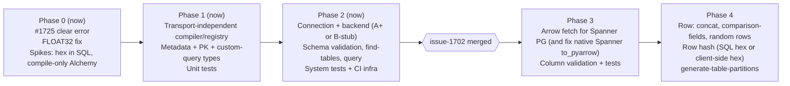
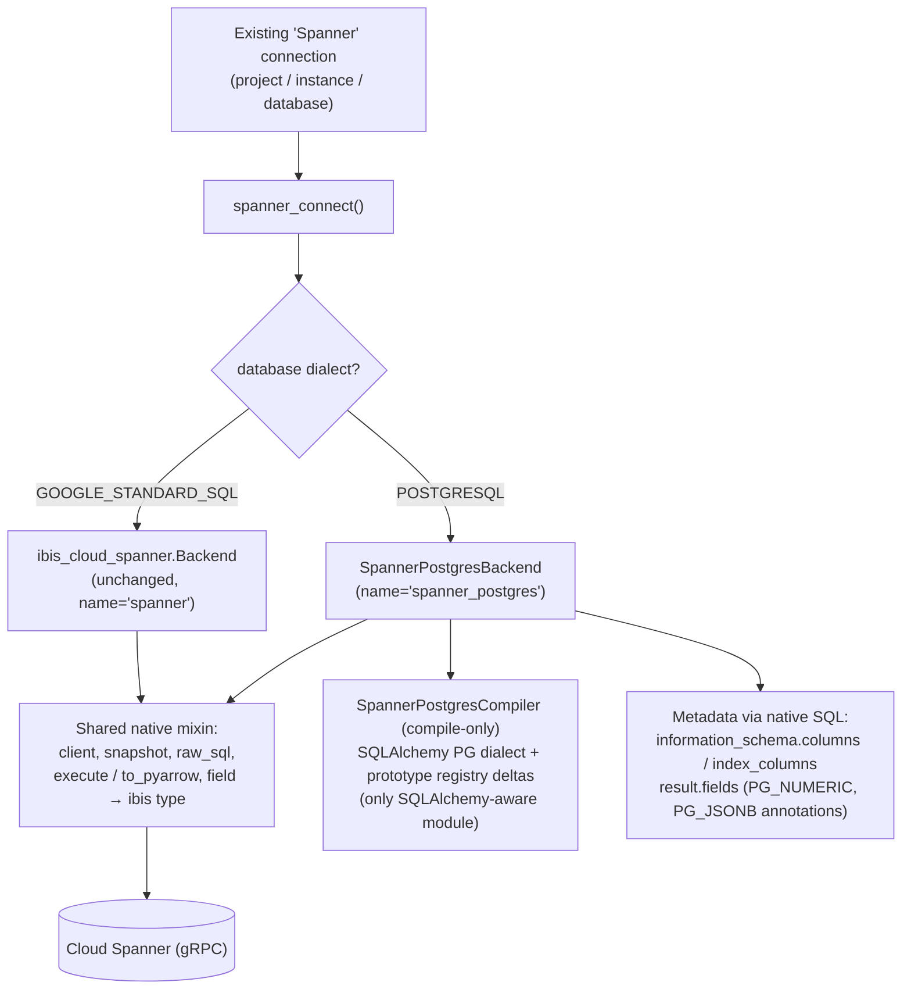
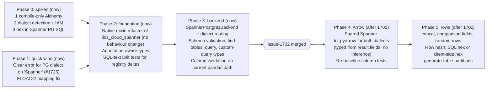

# Spanner PostgreSQL Dialect: Replan (issue #1725)

> [!IMPORTANT]
> **Decision (2026-11-09): Option B, native Spanner client with dialect auto-detection.** See [§7](#7-decision-option-b-design-and-revised-plan) for the design and revised phases. §3–§4 are kept as the record of the options considered.

Current branch: `1725-spanner-postgresql-dialect` (= `develop` @ `9669eef0`, Ibis 7.1.0, SQLAlchemy 2.0.51, google-cloud-spanner 3.69.0)

> [!NOTE]
> `spangres-experiment` was last merged with `develop` **after** the Ibis 7.1 upgrade (merge-base = 8.9.3, `d5507d41`), so the prototype code already targets Ibis 7.1. It merges into the current branch with **one conflict** (`tests/unit/test_clients.py`). `spangres-experiment` and `issue-1702-using-duckdb` share **no files**, so the 1702 dependency is about behaviour, not merge conflicts.

---

## 1. Branch review

### 1.1 `spangres-experiment` (prototype, ~1,250 lines, 16 files)

**Architecture:** PGAdapter sidecar (Java/Docker) → `psycopg2` → a new SQLAlchemy dialect `spanner_postgres+psycopg2` → `ibis_spanner_postgres.Backend(PostgresBackend)` with a copied and adjusted Postgres operation registry.

| Area | What the prototype did | Status |
|---|---|---|
| Connection | New `SpannerPostgres` source type: `--host`, `--port` (PGAdapter) | Works, but it has gaps (see below) |
| Reflection (`dialect.py`) | Rebuilds `get_columns` / `get_multi_columns` without `format_type()` (Spanner doesn't support it). Hard-codes `numeric` → `numeric(38,9)`. Stubs out PK/FK/index/constraint reflection. | Works for schema validation |
| PK detection | `list_primary_key_columns` via `information_schema.indexes` (`PRIMARY_KEY`) | Works (auto `-pks` test) |
| Session | `StaticPool`, `SET TIMEZONE = UTC`, `_safe_raw_sql` without a transaction | Works |
| Custom query types | `raw_column_metadata` uses `cursor.description` OIDs | Written, not tested end-to-end |
| Registry | `StringJoin` → `\|\|`, `Count(numeric/jsonb)` → cast to text, timestamp casts → `timestamptz`, drop `AT TIME ZONE`, `RawSQL`, `BinaryLength`, `PaddedCharLength`, epoch seconds | Works |
| Hash/bytea | `HashBytes` raises an error, `to_hex`/`from_hex` casts are knowingly broken | **Blocked: Spanner PG has no `encode(...,'hex')` or `to_hex`** |
| Other bits | `FLOAT32` mapping in `ibis_cloud_spanner/datatypes.py` (a real fix for GoogleSQL Spanner too); a whitespace-only Oracle change | Unrelated to the feature, can land on their own |
| Tests | `test_spanner_pg.py`: schema, column (no stddev: `stddev_samp(bigint)` unsupported), row concat, auto-pks, find-tables, raw query, connections add | Passed against a live PGAdapter |

**Not covered by the prototype:** generate-table-partitions, comparison-fields, random rows, custom-query validations, row hash, bytea columns in row validation, `--std`.

**Prototype defects to fix rather than copy:**
- `spanner_postgres_connect()` only accepts host/port/user/password, and it never passes a database. The unit test passes `project_id/instance_id/database_id`, so it **can't pass** as written.
- Code copied from the GoogleSQL backend that doesn't apply: `version` returns the Spanner client version, and `instance_id`/`dataset_id`/`database()` point at attributes that don't exist.
- `user="u"/password="p"` defaults that are then thrown away (`user=None`).
- `list_tables()` raises `NotImplementedError`, yet a find-tables test exists. Need to confirm which path find-tables actually takes.
- `numeric(38,9)` hides Spanner PG's arbitrary-precision `numeric`, which can give misleading schema validation results against BigQuery `BIGNUMERIC` or Postgres.
- Mixed copyright years/headers.

### 1.2 `issue-1702-using-duckdb` (the name is out of date: it now uses **PyArrow, not DuckDB**)

| Change | Effect on Spanner PG |
|---|---|
| `data_validation.py`: `client.execute()` → `client.to_pyarrow()` for source/target queries | **Changes what every backend must provide to fetch results** (pandas → Arrow) |
| `ibis_addon/operations.py`: global monkey-patch of `BaseSQLBackend.to_pyarrow_batches` and `BaseBackend.to_pyarrow` (per-column `pa.array()` inference via `_cursor_batches` → `_safe_raw_sql` → `fetchmany`) | Any new backend inherits this. How psycopg2/Spanner values (Decimal, tz-aware datetime, jsonb dict/list, bytes) become Arrow types is decided here |
| `combiner.py` rewritten in PyArrow: `pc.equal(src, tgt)` on native types, binary → `.hex()` for **display only**, timestamps → epoch seconds | Row comparison now needs **identical Arrow types** on both sides. A bytea hash compared with a hex-string hash raises a type error instead of failing the row |
| Spanner (GoogleSQL) backend not modified | `SpannerCursor` only has `fetchall()` (no `fetchmany()`), so the native Spanner backend's `to_pyarrow()` probably **breaks** on that branch. I haven't run it; `test_spanner.py` isn't listed in the branch's verification runs |
| Extra files (AGENTS.md, `combiner_capture.py`, design docs) | Not relevant |

---

## 2. What we can do now vs what waits for 1702

The rule: **anything that generates SQL or reads metadata can go ahead now. Anything that depends on the type or format of fetched results, or on how results are compared, should wait.**

| Work item | Now? | Why |
|---|---|---|
| Fail clearly when the existing `Spanner` connection hits a PG-dialect database (`Database.database_dialect == POSTGRESQL`). This is the exact #1725 report (backtick error) | ✅ Now | Small, helps users straight away, no fetch-path dependency |
| `FLOAT32` mapping fix in `ibis_cloud_spanner/datatypes.py` | ✅ Now | Separate bug fix |
| Connection plumbing: `consts`, `cli_tools`, `clients.CLIENT_LOOKUP`, secret manager, docs, unit tests | ✅ Now | Same under either option (see §3) |
| SQL generation: compiler and registry (`StringJoin`, `Count` casts, timestamptz casts, stddev cast, epoch seconds, padded char, `RawSQL`), with unit tests in `tests/unit/ibis_addon/test_compiler_matrix.py` style | ✅ Now | Compile-only, no execution path involved |
| Metadata: column reflection without `format_type`, PK detection, `raw_column_metadata` for custom queries, list schemas/tables for find-tables | ✅ Now | Doesn't go through the combiner |
| **Schema validation** end to end | ✅ Now | `schema_validation.py` doesn't use the combiner |
| `data-validation query`, `find-tables`, `connections add` system tests | ✅ Now | Don't use the combiner |
| generate-table-partitions | ⚠️ Now (low risk) | Uses `.execute()` in `partition_builder.py`, which 1702 doesn't touch |
| Test infra: Spanner PG database in the test project, DDL (`spanner_postgres_test_tables.sql`), PGAdapter in CI if Option A | ✅ Now | Independent |
| **Spike:** can Spanner PG make hex in SQL at all? (`CAST(bytea AS text)` output, any `spanner.*` function, `get_byte` workarounds) | ✅ Now | Decides the row-hash design |
| Column validation system tests (expected values/formats) | ⛔ Wait | Expected values depend on the combiner's `_format_value` and on decimal/timestamp handling, which 1702 rewrites |
| Row validation (concat/hash/comparison-fields/random rows) system tests | ⛔ Wait | Same, plus `pc.equal` strict typing |
| Row **hash** support (bytea → hex) | ⛔ Wait (unless the spike finds a SQL answer) | The fallback, hex-encoding a returned `sha256()` bytea client-side before comparing, fits naturally in 1702's Arrow fetch/combiner. Building it in the pandas combiner would be throwaway work |
| bytea/jsonb/numeric result normalisation (e.g. jsonb returned as dict/list) | ⛔ Wait | Decided by 1702's `pa.array()` inference |
| **Native-client execution (Option B)** | ✅ Now, *if it reuses the GoogleSQL Spanner fetch path* | Revised after choosing B (§7): if the PG backend shares the existing Spanner `execute()` → pandas code, it works end to end on `develop` today. When 1702 lands, both Spanner dialects move to `to_pyarrow` in **one** change (which 1702 probably needs anyway, see §1.2) |

> [!TIP]
> Column and row validations *can* be built now against the pandas combiner, but someone pays for re-baselining later. If Spanner PG lands first, 1702 has to carry it, and that adds work to an already large PR. Agreeing the merge order with the 1702 owner is the cheapest fix.

---

## 3. Implementation options

| | **A. PGAdapter + psycopg2** (prototype) | **A+. A, improved** | **B. Native `google-cloud-spanner` client, auto-detect dialect** | C. `spanner_dbapi` as a SQLAlchemy driver | D. `sqlalchemy-spanner` |
|---|---|---|---|---|---|
| User needs a sidecar | Yes (Java/Docker) | Yes | **No** | No | No |
| Connection type | New `SpannerPostgres` (host/port) | New `SpannerPostgres` (project/instance/database + PGAdapter host/port; DB passed as `projects/p/instances/i/databases/d`) | **Existing `Spanner`**, the dialect is detected | Existing `Spanner` | n/a |
| Fixes #1725 as reported (same connection, no extra steps) | No | No | **Yes** | Yes | n/a |
| Reuses prototype registry | Yes | Yes | Yes (compile with the SQLAlchemy PG dialect and send the SQL string to `snapshot.execute_sql`) | Yes | n/a |
| Reflection | pg_catalog emulation workarounds (`format_type` missing) | Same | Spanner's own schema API / `information_schema` (typed, already mapped in `ibis_cloud_spanner/datatypes.py` incl. `PG_NUMERIC`/`PG_JSONB` annotations) | pg_catalog through dbapi | n/a |
| Blocked by 1702 | Partly (results/compare) | Partly | **Mostly** (execution path) | — | — |
| Survives an Ibis 9/10 upgrade | **Poorly**: `dialect.py` and SQLAlchemy reflection go away (Ibis 9+ Postgres is sqlglot + psycopg directly) | Poorly | Better: only the compiler needs porting (to a sqlglot `PostgresCompiler` subclass); fetch/metadata stay native | — | — |
| Viability | Proven | Proven plus small changes | Needs a spike: an Ibis 7.1 `AlchemyCompiler` working from a hand-built `sa.Table` with no live engine | **Rejected**: the installed `spanner_dbapi` has no dialect awareness (rewrites params to GoogleSQL `@a0`) | **Rejected**: GoogleSQL only |

### Recommendation

1. **Ship the "now" items whichever option wins:** the #1725 clear error, the FLOAT32 fix, registry/compiler with unit tests, the hex spike, test DDL/infra.
2. **Choose between A+ and B before writing the backend.**
   - **B** is the better product (no sidecar, works with the connection users already create, fewer workarounds, holds up better through the Ibis upgrade the combiner review already expects). It depends more on 1702, and it carries one technical risk (compile-only Alchemy) that a ~1-day spike can settle.
   - **A+** can deliver schema validation, find-tables and query **now**, and column/row once 1702 lands. Its weak point is that the reflection layer gets rewritten at the next Ibis upgrade.
   - A reasonable middle path: build the registry/compiler so it's **independent of the transport**. Then A+ can ship first and B can be added later behind dialect detection, reusing the same compiler.

---

## 4. Proposed phases

---

## 5. Spikes / open technical questions

1. **Hex encoding in Spanner PG.** Check `CAST(sha256(x) AS text)` / `varchar` output (PG `\x…` format, base64, or an error?), any `spanner.*` hex/base64 function, and a `get_byte`-based expression. If none work: the hash column returns raw bytea and DVT hex-encodes it client-side before `pc.equal` (needs 1702). bytea columns *inside* concat/hash stay unsupported unless SQL hex exists.
2. **Compile-only Alchemy (Option B).** Can Ibis 7.1 compile row-hash and aggregate queries from a `sa.Table` built from Spanner schema metadata, using `SpannerPostgresDialect` with `literal_binds`, without a connection?
3. **`stddev_samp(bigint)`, `count(numeric)`.** Confirm the cast workarounds produce identical results to other engines.
4. **Schema semantics.** In GoogleSQL Spanner, DVT treats the "schema" part of `schema.table` as the database. In PG-dialect Spanner, real named schemas exist (default `public`). Decide the table-naming rules, especially for Option B on the shared `Spanner` connection type.
5. **numeric precision reporting.** Is `numeric(38,9)` acceptable, or should it map to an unbounded decimal?
6. **1702 + native Spanner.** Confirm whether `to_pyarrow()` works for the GoogleSQL Spanner backend on the 1702 branch (`SpannerCursor` has no `fetchmany`). If not, it's a 1702 bug, and fixing it is a prerequisite for Option B.

## 6. Decisions needed

- **Option A+ vs B** (or both, sharing one compiler).
- **Merge order** with the 1702 owner: does Spanner PG column/row support wait for 1702, or land first so 1702 has to cover it?
- Is a **PGAdapter dependency** acceptable for DVT's deployment targets (Cloud Run / Functions / containers)?

---

## 7. Decision: Option B, design and revised plan

### 7.1 Does B really mean less work at an Ibis upgrade? Yes, but not zero

From Ibis 9, every SQL backend compiles with **sqlglot**, and Postgres runs on psycopg directly. Both SQLAlchemy compilers *and* the string compilers (which today's GoogleSQL Spanner backend uses) are removed.

| Layer | Option A at Ibis 9/10 | Option B at Ibis 9/10 |
|---|---|---|
| Compiler / operation registry (Spanner PG SQL differences) | **Rewrite** as a sqlglot `PostgresCompiler` subclass | **Rewrite** as a sqlglot `PostgresCompiler` subclass (same cost) |
| Reflection / metadata | Rewrite: SQLAlchemy `dialect.py` goes away, and Ibis 9 Postgres `get_schema` still uses `format_type()`, which Spanner lacks, so it needs overriding again | **No change**: native Spanner `information_schema` / result-set field types |
| Connection / session / driver | Rebase onto the new psycopg Postgres backend, keep PGAdapter | **No change**: `google-cloud-spanner` |
| Result fetching | Follows whatever Postgres does | Shared with GoogleSQL Spanner, so ported **once** for both dialects |

So B avoids reworking reflection, connection and fetch, and shares the port of the native plumbing with the GoogleSQL Spanner backend, which has to be ported anyway. The **compiler gets rewritten under either option.** To keep that cost low:

> [!TIP]
> Keep everything SQLAlchemy-specific in **one module** (`compiler.py` + `registry.py`), and keep a written list of the Spanner PG SQL differences (e.g. "`concat_ws` → `||`", "`count(numeric)` → `count(CAST(x AS text))`") as unit tests that check the **generated SQL text**. Those tests carry over to the sqlglot compiler unchanged, and they act as the port's acceptance suite.

### 7.2 Target architecture (Ibis 7.1)

Key design points:
- **No new connection type.** `spanner_connect()` returns a different backend class depending on the dialect. It needs its own `name` because DVT branches on `client.name` in many places (`clients.py`, query builder, `ibis_addon/operations.py`).
- **Dialect detection.** `Database.database_dialect` calls `reload()` (the admin `GetDatabase` RPC) when the dialect is unknown, which may need more than `roles/spanner.databaseReader`. Fallback: a data-plane probe that works in both dialects, e.g. `SELECT count(*) FROM information_schema.schemata WHERE schema_name = 'pg_catalog'` (to be checked in the spike), plus an optional connection override.
- **Compile-only SQLAlchemy.** Build `sa.Table` objects from native metadata and compile Ibis exprs with a driverless `SpannerPostgresDialect(PGDialect)` using `literal_binds`. Send the SQL string to `snapshot.execute_sql`. The prototype's `dialect.py` reflection workarounds are **not needed**.
- **Types.** Extend `ibis_cloud_spanner/datatypes.py` to respect `type_annotation` (`PG_NUMERIC` → arbitrary-precision decimal instead of `NUMERIC(38,9)`, `PG_JSONB` → json). Custom-query column types come from `result.fields`, so the psycopg2 OID map isn't needed.
- **Schemas.** PG dialect has real schemas (`Database.default_schema_name == "public"`). `schema.table` in DVT means a real PG schema for this backend, not the database as it does for GoogleSQL Spanner.
- **Prototype pieces to carry over:** the registry deltas (`StringJoin`, `Count` casts, timestamptz casts, no `AT TIME ZONE`, `RawSQL`, `BinaryLength`, `PaddedCharLength`, epoch seconds), the PK query against `information_schema.index_columns`, the test DDL, and `test_spanner_pg.py` (with the PGAdapter config replaced by Spanner instance/database config).
- **Prototype pieces to drop:** PGAdapter, psycopg2 dialect registration, `dialect.py`, the OID map, `StaticPool`/`SET TIMEZONE` (Spanner timestamps are UTC through the native API), and the `SpannerPostgres` connection type/CLI/docs.

### 7.3 Revised phases

> [!NOTE]
> Superseded by the sequencing in [§8](#8-sequencing-decision-blocked-on-1702), which keeps this branch blocked until 1702 lands.

| Phase | Scope | Blocked by 1702? | Exit criteria |
|---|---|---|---|
| 0 Spikes | (1) Compile a row-hash and an aggregate query against a hand-built `sa.Table` with no engine. (2) `database_dialect` with `databaseReader`-only credentials, plus the probe-query fallback. (3) Hex encoding options in Spanner PG | No | Go/no-go on compile-only. Detection method chosen. Hash design chosen |
| 1 Quick wins | Clear error when the existing `Spanner` connection hits a PG database. `FLOAT32` mapping | No | Separate small PRs merged |
| 2 Foundation | Pull client/snapshot/raw_sql/execute/type mapping out of `ibis_cloud_spanner.Backend` into a mixin with no behaviour change. Annotation-aware types. Registry deltas with SQL-text tests | No | `test_spanner.py` and unit tests unchanged and green |
| 3 Backend | `SpannerPostgresBackend`, routing in `spanner_connect`, metadata, PK detection, schema/find-tables/query/custom-query types, column validation via the shared pandas `execute()` | No (column test baselines will move after 1702) | `test_spanner_pg.py` schema/column/find-tables/query tests green |
| 4 Arrow | Implement `to_pyarrow` for the shared mixin (fixes GoogleSQL Spanner on the 1702 path too). Re-baseline column tests | **Yes** | Both Spanner suites green on the Arrow path |
| 5 Rows | Concat, comparison-fields, random rows, partitions, row hash (bytea hex normalisation if needed) | **Yes** (hash and type strictness) | Full `test_spanner_pg.py` parity with `test_spanner.py` |

### 7.4 Risks

- **Compile-only Alchemy turns out awkward in Ibis 7.1.** `BaseAlchemyBackend` assumes a live engine in many places. Fallback: put a SQLAlchemy mock engine (`create_mock_engine`) behind the backend, or write a small string compiler. Either way it's still confined to the compiler module.
- **Detection needs admin IAM.** Covered by the probe-query fallback and an explicit override.
- **No SQL hex function.** Row hash then depends on client-side hex after 1702, and bytea columns *inside* concat/hash stay unsupported. That needs documenting.
- **The 1702 merge order slips.** Phases 0–3 deliver user value (clear error, schema validation, column validation) without it.

### 7.5 Still open

- ~~Does the 1702 owner agree that `to_pyarrow` for the shared Spanner mixin (Phase 4) belongs in 1702 or straight after it?~~ **Decided:** GoogleSQL Spanner `to_pyarrow` goes on 1702 (§8).
- ~~Keep a PGAdapter path at all?~~ **Decided:** dropped (§8).

---

## 8. Sequencing decision: blocked on 1702

**Decided (2026-11-09):**
- `to_pyarrow` for the GoogleSQL Spanner backend is done **on 1702**.
- This branch stays **blocked until 1702 is merged** (revisit if 1702 is slow, see §8.4).
- **The PGAdapter path is dropped.** No `SpannerPostgres` connection type, no psycopg2 dialect, no PGAdapter docs or CI.

### 8.1 What changes because 1702 owns Spanner `to_pyarrow`

- The **shared native mixin refactor** of `ibis_cloud_spanner/__init__.py` (old Phase 2) would conflict with 1702's Spanner changes, so it **moves after 1702**.
- `ibis_cloud_spanner/datatypes.py` (annotation-aware types) is likely touched by 1702's Arrow conversion too, so that also waits.
- Anything in **new files** (`third_party/ibis/ibis_spanner_postgres/*`, new unit tests) can't conflict, so it can be written now and sit on this branch.

### 8.2 Work that doesn't need to wait

| Item | Where | Why it's safe |
|---|---|---|
| Clear error when the existing `Spanner` connection hits a PG-dialect database (#1725) | **Separate small PR off `develop`** | ~10 lines in `do_connect`. A trivial conflict at worst. Turns today's confusing backtick error into a clear message |
| `FLOAT32` → `dt.float32` mapping | **Separate small PR off `develop`** | One-line bug fix for GoogleSQL Spanner |
| Spikes: compile-only Alchemy, dialect detection IAM / probe query, hex in Spanner PG SQL | Scratch / this branch | No production code |
| Compiler + registry deltas + SQL-text unit tests | This branch (new files only) | Doesn't touch 1702's files. This is also the acceptance suite for the later sqlglot port |
| Test DDL for the Spanner PG test database, creating the test database | This branch / test project | Independent |

### 8.3 Asks for the 1702 owner (cheap now, saves rework later)

1. Implement Spanner `to_pyarrow` from **`result.fields` types** (explicit Arrow schema), not `pa.array()` inference. That way a `PG_NUMERIC` / `PG_JSONB` `type_annotation` can be honoured by adding a mapping entry later.
2. Keep the fetch → Arrow conversion in a **standalone helper** (not inlined in `Backend`) so the PG backend can reuse it without a refactor.
3. Add `tests/system/data_sources/test_spanner.py` to 1702's verification runs (`SpannerCursor` has no `fetchmany()` today).

### 8.4 If 1702 is slow: suggested triggers and fallback

**Triggers to revisit:** 1702 not merged by an agreed date, a customer escalation on #1725, or 1702's scope growing further (e.g. combiner capture tooling or Ibis upgrade work getting folded in).

**Fallback:** build `SpannerPostgresBackend` by **subclassing / reusing the current GoogleSQL Spanner `execute()` → pandas path**, and ship schema, find-tables, query and column validation. Row validation stays out of scope.

| Cost of the fallback | Who pays |
|---|---|
| Column-validation test expectations re-baselined after 1702 | This feature, small |
| 1702 must carry one more backend in its Spanner `to_pyarrow` change | 1702. Close to free if the PG backend inherits the GoogleSQL fetch path instead of overriding it |
| Possible conflicts in `ibis_cloud_spanner/__init__.py` | Whoever merges second. Kept small by not doing the mixin refactor in the fallback |

> [!TIP]
> Because the fallback **inherits** rather than refactors the GoogleSQL backend, switching to it later is cheap. That's why the "blocked" decision is low-risk: the work done now (spikes, compiler, tests) is identical under both paths.

### 8.5 Updated phase list

| # | Phase | When |
|---|---|---|
| 0 | Quick-win PRs (#1725 clear error, FLOAT32) + spikes | Now |
| 1 | Compiler/registry deltas + SQL-text unit tests, test DDL (new files on this branch) | Now |
| — | **1702 merged** (includes GoogleSQL Spanner `to_pyarrow`) | — |
| 2 | Rebase. Pull out the shared native fetch/metadata helpers. Annotation-aware types | After 1702 |
| 3 | `SpannerPostgresBackend` + dialect routing. Schema, find-tables, query, custom-query types, column validation | After 1702 |
| 4 | Row validation (concat, comparison-fields, random rows), row hash, generate-table-partitions | After 1702 |
